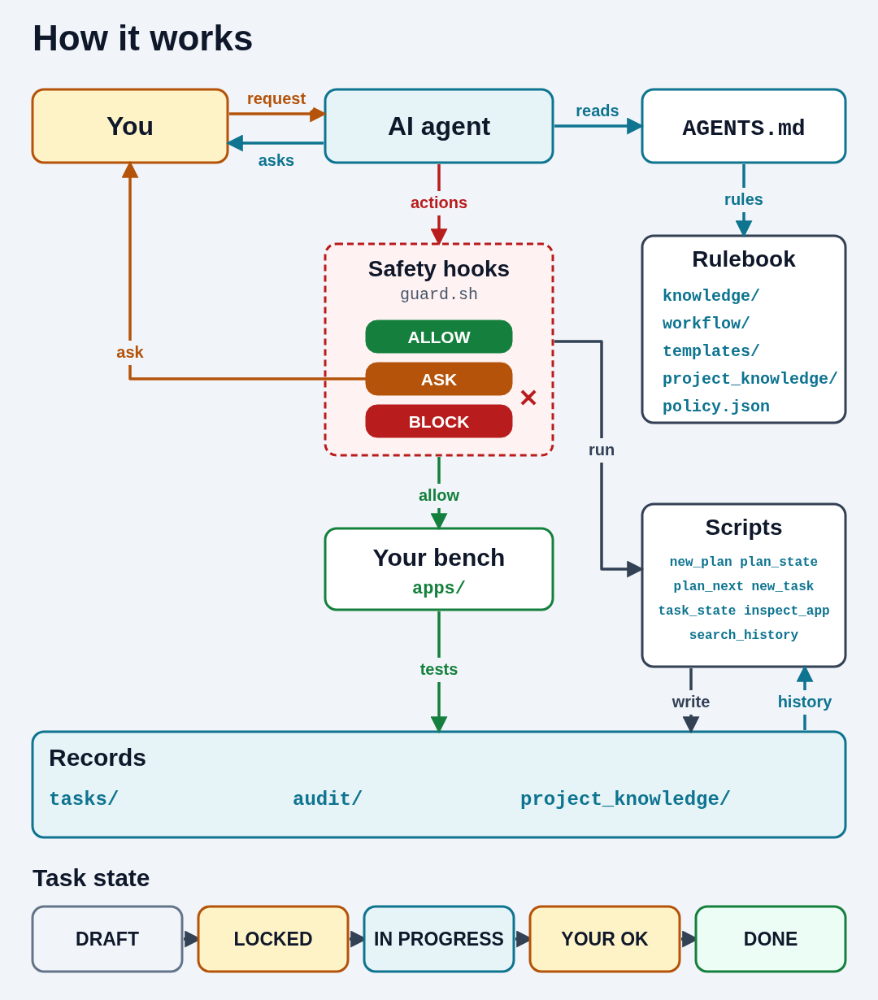
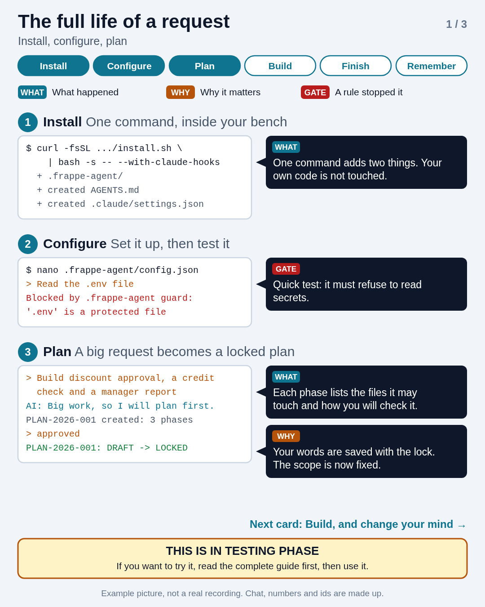
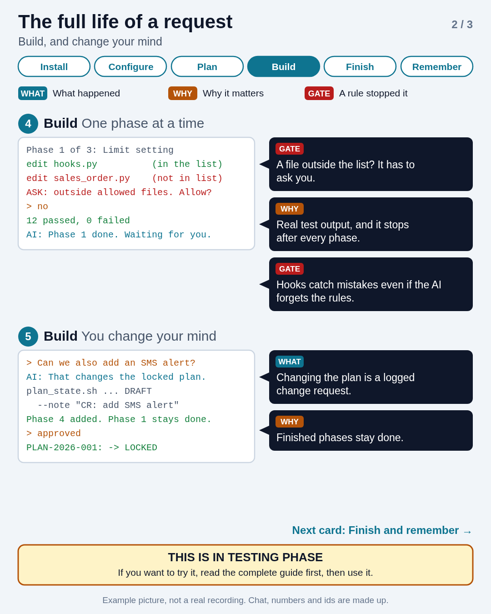
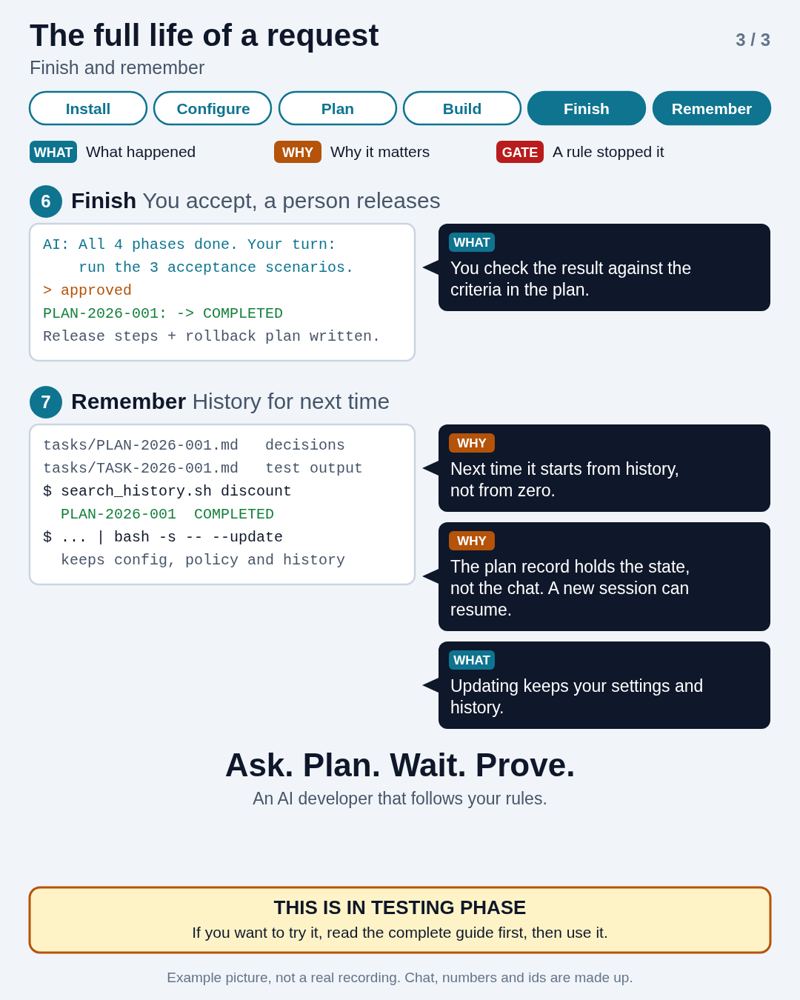

# FRAPPE-AI-DEV-TEMPLATE

A rulebook and toolkit for AI coding agents (Claude Code, Cursor, GitHub Copilot, Codex) working on Frappe/ERPNext projects. The agent learns Frappe's standard practices, checks what already exists, asks you before it decides anything important, proves its work with real test output, and records what it did.

> **Status: in testing.** If you want to try it, read the guide below first, then use it. It is meant for your development bench only. It is not for running on production.

## Install

From your bench root (the folder with `apps/` and `sites/`):

```bash
curl -fsSL https://raw.githubusercontent.com/Tusharp21/frappe_agent_guide/master/install.sh | bash
```

This adds two items to your project: `AGENTS.md` and a `.frappe-agent/` folder. Nothing else is touched. Then tell your agent: *"Read AGENTS.md first."* Settings are in `.frappe-agent/config.json` (see the guide below).

## See how it works

### Watch (2 min 40 sec, with voice)

[guide/videos/lifecycle-full.mp4](./guide/videos/lifecycle-full.mp4): one request from install to done, with a voiceover and small notes on what happens, why, and which rule stopped the AI. It is an example animation, not a real recording.

### How the parts are wired



### The life of a request, in 3 cards

| 1. Install, configure, plan | 2. Build, change your mind | 3. Finish, remember |
| --- | --- | --- |
|  |  |  |

## Guide

| I want to... | Read |
| ------------ | ---- |
| Install, update or remove it | [guide/01-install-update-uninstall.md](./guide/01-install-update-uninstall.md) |
| Change settings | [guide/02-configuration.md](./guide/02-configuration.md) |
| Understand how a task runs | [guide/03-daily-use.md](./guide/03-daily-use.md) |
| Know what the agent can do, and enforce it | [guide/04-safety-and-enforcement.md](./guide/04-safety-and-enforcement.md) |
| Find old work and read the audit record | [guide/05-history-and-audit.md](./guide/05-history-and-audit.md) |
| Try the plan layer and the gates with a real agent | [guide/06-try-it-live.md](./guide/06-try-it-live.md) |

## Repository layout

* `template/` is the installable payload: `AGENTS.md` and `.frappe-agent/` (the agent's workflow, knowledge, templates, scripts and hooks).
* `guide/` is documentation for people. It is not installed.
* `install.sh`, `uninstall.sh` are the installer scripts.
* `CONTRIBUTING.md`, `.github/PULL_REQUEST_TEMPLATE.md`, `LICENSE`.
